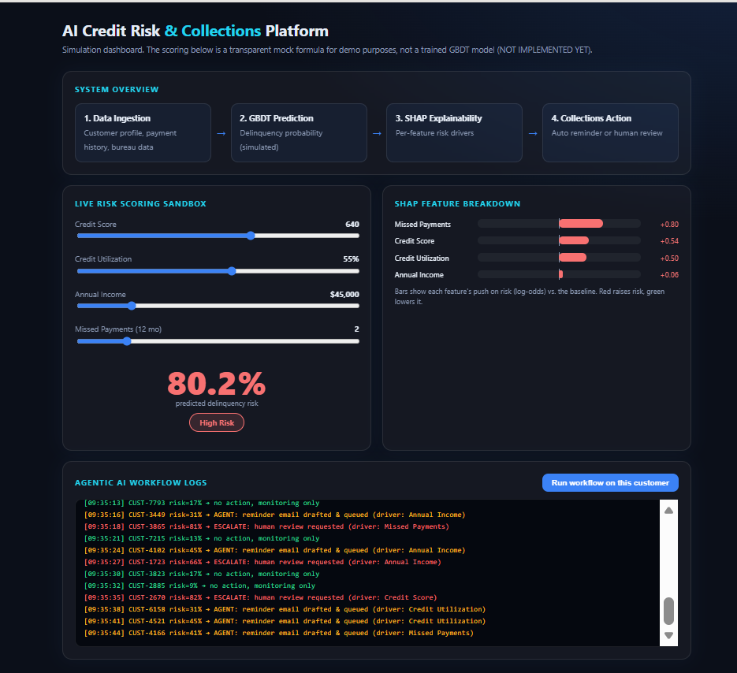

# AI-Powered Credit Risk & Collections Platform

An interactive single-page web dashboard simulating an end-to-end automated credit collections workflow inspired by the Tata iQ Data Analytics simulation.

## Features
- **Live Risk Scoring Sandbox:** Real-time risk probability calculation based on customer credit metrics.
- **SHAP Feature Breakdown:** Transparent feature importance visualizer explaining key risk drivers.
- **Agentic AI Workflow Logs:** Live terminal logs automating low-risk reminders vs. escalating high-risk accounts to human review.